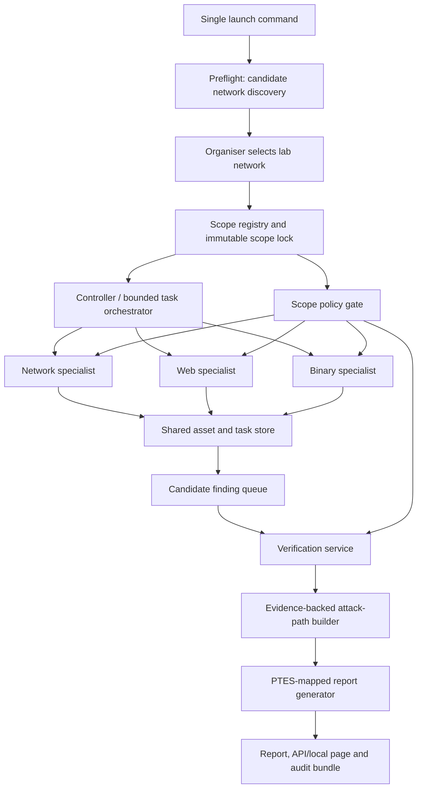

# Architecture

Logical component map (spec section 4) followed by how coordination actually
happens. The diagram is logical - boxes are Python modules in one process plus
bounded tool subprocesses, not microservices, for the first release.

## Component ↔ code map

| Component (spec 5.x) | Module | Status |
|---|---|---|
| CLI/local control page | `src/cart/cli.py` | commands scaffolded: `preflight run status report` |
| Candidate Network Discovery | `src/cart/preflight.py` | stub → build step 2 |
| Scope Registry & Policy Gate | `src/cart/scope.py` | fail-closed IP/CIDR/host/binary checks implemented |
| Controller/Orchestrator | `src/cart/orchestrator.py` | task graph + state machine implemented; scheduling wiring → step 4 |
| Network Worker | `src/cart/workers/network.py` | stub → step 5 (Nmap XML adapter candidate) |
| Web Worker | `src/cart/workers/web.py` | stub → step 6 (Katana/ZAP candidates) |
| Binary Worker | `src/cart/workers/binary.py` | hash verification implemented; analysis → step 6 (Ghidra headless candidate) |
| Verification Service | `src/cart/verify.py` | stub → step 7 |
| Attack-path Builder | `src/cart/attackpath.py` | stub → step 8 |
| Report Generator/API | `src/cart/report.py` | stub → step 8 |
| Shared store | `src/cart/models.py` + `store.py` | full record set + SQLite DDL implemented |

## Agent coordination model (spec section 8)

- **One controller, three specialists** in a bounded task graph. No agent
  mesh, no unbounded delegation.
- Specialists propose follow-up tasks using **registered task types only**;
  the orchestrator owns dedupe keys, budgets, and ordering.
- Workers communicate exclusively through the shared typed records — never
  free-form chat, never hand-offs of raw shell commands.
- Framework decision (LangGraph vs custom runner vs CrewAI) is deliberately
  deferred; the current `orchestrator.py` IS the small custom task-graph
  runner baseline, and the comparative spike can still pick a framework later
  without changing worker contracts.

## Storage

SQLite (`run_id`-scoped tables: runs, assets, services, tasks, tool_events,
findings, evidence, relationships, report_artifacts) + filesystem artifacts
for raw tool outputs and the report. Graph edges live in the `relationships`
table — no graph database in v0.1.

## Deployment (spec section 11)

Single machine, compact Python app, SQLite, bounded subprocess adapters.
Docker Compose optional. Three laptops are development/validation machines —
the product must not need them connected at runtime.
