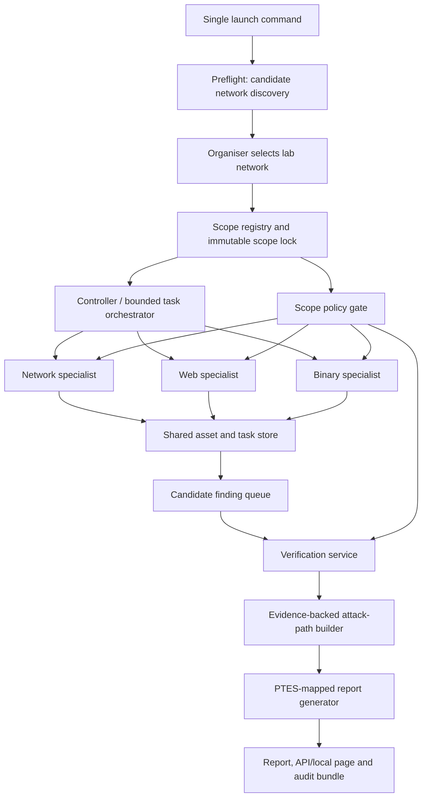

# Architecture

Logical component map (spec section 4) followed by how coordination actually
happens. The diagram is logical - boxes are Python modules in one process plus
bounded tool subprocesses, not microservices, for the first release.

## Component ↔ code map

| Component (spec 5.x) | Module | Status |
|---|---|---|
| CLI/local control page | `src/cart/cli.py`, `src/cart/ui.py` | `preflight`, `select`, `run`, `status`, `report`, and `ui` commands implemented; default dashboard bind is localhost |
| Candidate Network Discovery | `src/cart/preflight.py` | Windows/POSIX local interface and route metadata; candidate listing only, no probing |
| Scope Registry & Policy Gate | `src/cart/scope.py` | fail-closed IP/CIDR/host/binary checks implemented |
| Controller/Orchestrator | `src/cart/orchestrator.py` | SQLite-backed task scheduling, deduplication, bounded concurrency, budgets, retries, and state transitions implemented |
| Network Worker | `src/cart/workers/network.py` | Nmap XML adapter + zero-dependency stdlib TCP socket scan fallback when nmap is missing or fails at runtime; normalises to canonical Asset/Service records |
| Web Worker | `src/cart/workers/web.py` | stdlib gate-checked crawler: forms/endpoints, planted-flag hunt (body / HTML comments / HTTP headers), binary-link discovery (`.exe/.bin/.elf/.so/.dll`) with hash registration and task hand-off |
| Binary Worker | `src/cart/workers/binary.py` | hash-verified static analysis: header parse, strings, planted-flag hunt, unsafe libc function table (`strcpy/gets/system/sprintf/popen/strcat` → `binary_unsafe_function`) |
| Remediation Advisor | `src/cart/advisor.py` | rule-based plain-English advisories + git-appliable `.patch` files via `export_patches()` for CONFIRMED findings, verified with `git apply --check` (build step 9) |
| Agent Tracer | `src/cart/tracing.py` | span tracing to `traces/agent_traces.jsonl`; optional LangSmith export when `LANGSMITH_API_KEY`/`LANGCHAIN_API_KEY` is set |
| Verification Service | `src/cart/verify.py` | deterministic finding playbooks and evidence-backed status transitions implemented |
| Attack-path Builder | `src/cart/attackpath.py` | evidence-backed attack path from relationships table; interactive SVG rendered by local web dashboard |
| Report Generator / Local Web Dashboard | `src/cart/report.py` + `ui.py` | consolidated Markdown/JSON report generation + zero-dependency localhost control page (multi-agent status, CTF trophy case, PolicyGate audit logs, node inspection `/api/asset`, patch export `/api/patches`) |
| Shared store | `src/cart/models.py` + `store.py` | full record set + SQLite DDL implemented |

Implementation status does not mean lab-validated: controlled target runs,
ground-truth scoring, and performance benchmarks remain pending (see
`docs/build-plan.md`).

## Agent coordination model (spec section 8)

- **One controller, three specialists** in a bounded task graph. No agent
  mesh, no unbounded delegation.
- Specialists propose follow-up tasks using **registered task types only**;
  the orchestrator owns dedupe keys, budgets, and ordering.
- Workers communicate exclusively through the shared typed records — never
  free-form chat, never hand-offs of raw shell commands.
- **Web→Binary agent hand-off:** when the Web Worker crawls a path ending in a
  binary artefact extension (`.exe .bin .elf .so .dll`), it downloads the file
  (bounded size cap), saves it locally, computes SHA-256, and registers the
  local copy with the PolicyGate for **static analysis only** — then the
  orchestrator `on_binary_discovered` hook enqueues a
  `binary_static_analysis` task (`owner="binary"`, dedupe key
  `<run_id>:bin:<path>`). No human intervention after scope lock.
- Framework decision (LangGraph vs custom runner vs CrewAI) is deliberately
  deferred; the current `orchestrator.py` IS the small custom task-graph
  runner baseline, and the comparative spike can still pick a framework later
  without changing worker contracts.

## Storage

SQLite (`run_id`-scoped tables: runs, assets, services, tasks, tool_events,
findings, evidence, relationships, report_artifacts) + filesystem artifacts
for raw tool outputs and the report. Graph edges live in the `relationships`
table — no graph database in v0.1. CLI worker threads receive independent
SQLite connections; PolicyGate audit writes use the current worker thread's
connection and are serialized. Scheduling and state transitions remain on the
controller connection.

## Deployment (spec section 11)

Single machine, compact Python app, SQLite, bounded subprocess adapters.
Docker Compose optional. Three laptops are development/validation machines —
the product must not need them connected at runtime.
