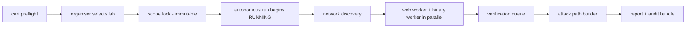

# How CART works — one run, end to end

This page explains the full operating story in practical terms: what the
operator does once, and what the engine then does alone. It is the plain
language answer to "how will the project run?" and "how is it autonomous?"

## The 30-second version

1. The operator launches CART **once** (`cart preflight` → select → run).
2. CART shows the networks the laptop can see. **The organiser picks the lab** —
   never the software.
3. The accepted targets are locked in an immutable scope manifest.
4. The run starts. From that moment **no human input is required**: the
   coordinator spawns discovery, webs, binary analysis, verification, attack
   path, and the final report on its own within hard budgets.
5. The team receives one report with evidence, metrics, and an attack path.

## Phase-by-phase

### Phase A — Launch and candidate discovery
`cart preflight` reads the laptop's own network configuration: interfaces,
addresses, prefixes, gateways, VPN/virtual adapters. It **does not scan** — it
lists candidates and flags ambiguous or virtual ones. (Spec section 5.2.)

### Phase B — Organiser selects the lab
The organiser names which candidate is the lab and gives exclusions plus the
supplied binaries. This is the only required human decision, and it is the
data that becomes the run's **immutable scope manifest**. This distinction -
candidate network ≠ authorised scope - is the heart of the project (spec
Appendix B).

### Phase C — Scope lock and run initialisation
Before any worker starts, the controller validates: selected prefix parses,
exclusions are explicit, binary hashes are registered, tier and budgets are
set, and the PolicyGate can resolve every target. The operator hits start;
`RUNNING` is the autonomy boundary.

### Phase D — Network discovery
The Network Worker finds live hosts, ports, and services **inside the locked
scope only**, normalises tool output (Nmap XML adapter), and writes canonical
asset/service records to the shared store. It raises follow-up tasks; it does
not decide to attack anything.

### Phase E — Parallel specialist assessment
The orchestrator schedules independent work simultaneously: Web Worker tasks
for each in-scope web service, Binary Worker tasks for each organiser-supplied
binary. Workers exchange typed records — never shell commands — and cannot
modify the scope or each other's privileges.

### Phase F — Finding verification
Candidates land in a verification queue. Outcomes: `CONFIRMED` (repeatable
evidence), `REJECTED`, `INCONCLUSIVE`, `NEEDS_REVIEW` (human decision;
exceptional). A scanner message alone never becomes confirmed.

### Phase G — Attack-path construction
Paths are built **only** from relationships that carry evidence. Being on the
same network is not a path edge.

### Phase H — Report and completion
One consolidated report: exec summary, scope + exclusions, full inventory,
findings with severity/PTES/evidence/remediation, evidence-backed attack path,
metrics (coverage, verification, false alarms, scope safety, runtime,
autonomy), and tool execution summary. Run ends `COMPLETED`, `PARTIAL`, or
`ABORTED` with a reason.

## What is autonomous, precisely

| Decision | Who makes it | Example |
|---|---|---|
| Which network is the lab | **Organiser** (once, pre-run) | picks candidate B |
| Which targets are tested | Locked manifest (immutable during run) | 10.10.20.0/24 minus exclusions |
| Every tool action destination | PolicyGate (deterministic code) | deny 10.9.9.9 probe |
| What to scan next | Orchestrator schedule + budgets | web tasks for :80/:443 hits |
| Which finding is real | Verification Service | CONFIRMED with evidence |
| When to stop | Run budget / stop state | 20-min PRD target |
| Anything beyond scope | **Nobody** | denied + audited |

Autonomy is **bounded**: finite task budgets, concurrency caps, timeouts,
retry caps, output caps, and stop conditions. "Agentic" does not mean
uncontrolled - after scope lock the engine needs zero further input because
every possible choice is already policy- or budget-resolved.

## Run states

`PENDING → PREFLIGHT → RUNNING → COMPLETED | PARTIAL | ABORTED`

Interventions after `RUNNING` are counted as a PRD "autonomy" metric; organiser
interactions are recorded with timestamps to keep the measurement honest.
