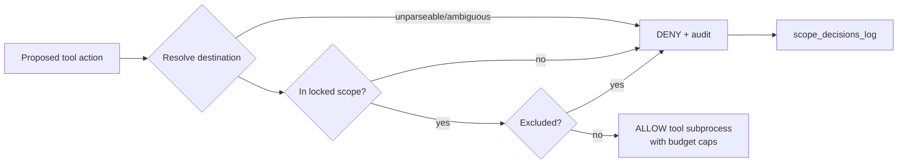

# Safety — scope policy and operational rules

The PRD's hard requirements: test only within the given scope; do not damage
or take down targets. Zero out-of-scope probes is a measured target with a
"Great" threshold (PRD acceptance table).

## The policy gate

`src/cart/scope.py::PolicyGate` is the single authority for "may this action
run?". Every tool action from every component passes it immediately before
execution, including retries and redirected web requests.

Properties:

- **Fail closed.** Missing manifest, ambiguous candidate, unresolvable IP,
  unknown binary file → all DENY with a recorded reason.
- **Exclusions win** over included prefixes.
- **Redirect re-check.** Every web redirect/linked destination is re-validated;
  out-of-scope redirects are rejected before urllib sends a request to the
  redirected destination and are logged by the PolicyGate.
- **Registered binaries only.** The binary worker reads only hash-registered
  organiser files; hash mismatch = reject + record. One auditable exception:
  files **downloaded by the Web Worker from an already-gate-allowed in-scope
  URL** (web→binary hand-off) may be registered at run time via
  `PolicyGate.register_dynamic_binary` and analysed **statically only** (never
  executed). The locked manifest itself is never mutated by this — the target
  destination was already authorised, so no scope expansion occurs — and every
  registration is recorded in the audit log with its reason. Anything else
  (unregistered, mismatched hash, direct filesystem pick-up) stays DENY.
- **Immutable scope.** Locked manifest never changes mid-run; new targets
  require a new scope version and re-approval.

## Practise-safe defaults while developing

- Testing Mitigata infrastructure is a **separate** stage from the hackathon
  lab and follows the organisers' stated permission.
- Development machines **never** double as scan targets by accident: local
  tests run against a dedicated validation lab network (Laptop 3 hosts it)
  or loopback mocks — never against random LAN devices.
- OWASP Juice Shop is only a proposed validation target, not authorization.
  Use it only after organiser approval and only as an isolated instance with
  an explicitly locked scope. Do not assess public or internet-accessible
  instances; record the scope decision and lab-side evidence for validation.
  The local development recipe in `labs/juice-shop/README.md` uses an internal
  Docker network and runs CART in the app container's network namespace. Its
  CART example restricts discovery to port 3000, so no host port is published
  and other host services are not probed.
- Masscan is banned in the repo config until benchmarks + organiser limits
  justify it.
- Static analysis only for binaries by default (no dynamic execution of
  untrusted samples without an explicit sandbox decision in this file).

## Audit requirements

For every run: all allow/deny decisions, all tool events (tool version,
target, scope decision, timestamps, exit status, output hash), and the count
of operator interventions after `RUNNING` — these feed the scope-safety and
autonomy metrics in the report.
